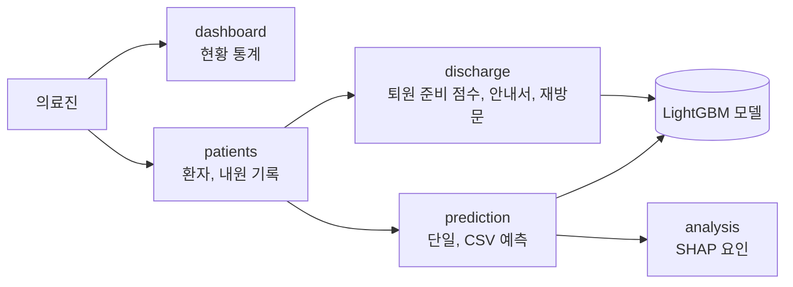

# ReCare-DM — 당뇨 환자 재입원 위험 관리 대시보드

> 팀 프로젝트의 사본입니다. 원본은 `Yun-sooyong/ReCare-DM-Dashboard`(비공개)입니다.
> 커밋 기록과 작성자는 원본과 같습니다. 원본 기록에서 개발용 키 값을 지웠고, 서버가 켜지지 않던 문제를 고쳤습니다.

당뇨 환자의 재입원 위험을 예측하고, 퇴원 준비 상태를 점수로 보여 주는 의료진용 웹 대시보드입니다.
예측 결과마다 위험을 높이는 요인과 낮추는 요인을 SHAP으로 함께 보여 줍니다.

| 항목 | 내용 |
|---|---|
| 기간 | 2026.06 (5일) |
| 인원 | 5명 |
| 내 역할 | 퇴원 관리 앱(`discharge`), 환자 모델 수정, 재방문 재예측, 앱 통합. 팀 커밋 116개 중 53개 |

## 핵심 가치

1. **퇴원 판단을 숫자로:** 퇴원 준비 상태를 5개 항목, 100점 만점으로 계산합니다. 점수가 낮은 항목부터 보여 줍니다.
2. **예측 이유를 함께:** 재입원 확률 옆에 위험 요인 5개와 보호 요인 5개를 SHAP 값으로 보여 줍니다.
3. **재방문하면 다시 예측:** 퇴원 뒤 재방문 정보를 넣으면 재입원 위험을 다시 계산합니다.

## 내가 만든 것

| 한 일 | 내용 |
|---|---|
| 퇴원 준비 점수 (`discharge/views.py`의 `compute_readiness`) | 5개 항목 × 20점. 80점 이상 "양호", 60점 이상 "주의 필요", 그 아래 "집중 지원 필요" |
| 퇴원 안내서 화면과 인쇄 화면 | 항목별 점수, 부족한 항목과 권고 문구 |
| 재방문 입력과 재예측 | 재방문 기록을 저장하고 모델로 위험을 다시 계산 |
| 환자 모델 수정과 앱 통합 | 환자, 예측, 분석 앱이 같은 환자 기록을 쓰도록 연결 |

퇴원 준비 점수 항목은 아래와 같습니다.

| 항목 | 20점 | 낮은 점수 |
|---|---|---|
| 재입원 위험도 | 30% 미만 | 30~50% 14점, 50~70% 8점, 70% 이상 4점 |
| 이전 입원 횟수 | 0회 | 1회 14점, 2~3회 8점, 4회 이상 4점 |
| 응급실 방문 횟수 | 0회 | 1회 14점, 2~3회 8점, 4회 이상 4점 |
| 약물 안정성 | 처방 변경 없음 | 변경 있음 10점 |
| 퇴원 경로 | 자택 귀가 | 가정 간호 16점, 그 밖 10점 |

## 구조

| 앱 | 주소 | 내용 |
|---|---|---|
| `dashboard` | `/`, `/dashboard/` | 첫 화면, 위험 등급별 통계 |
| `patients` | `/patients/` | 환자 목록, 상세, 등록, 수정, 내원 기록 |
| `prediction` | `/prediction/` | 단일 입력 예측, CSV 일괄 예측 |
| `analysis` | `/analysis/<예측 ID>/` | SHAP 위험 요인과 보호 요인 |
| `discharge` | `/discharge/` | 퇴원 안내서, 인쇄, 재방문 재예측 |

## 기술 스펙

| 영역 | 기술 |
|---|---|
| 백엔드 | Django 6.0, SQLite(개발), PostgreSQL(배포, `DATABASE_URL`) |
| 모델 | LightGBM 4.6, scikit-learn 1.9, SHAP 0.52, pandas 3.0 |
| 배포 | gunicorn, WhiteNoise, `Procfile` |

## AI 모델

| 항목 | 내용 |
|---|---|
| 모델 | LightGBM 이진 분류 (`recareDMD/lgbm_model.pkl`) |
| 입력 | 입원 기간, 검사·시술·투약 횟수, 외래·응급·입원 횟수, 진단 코드, 혈당·당화혈색소, 당뇨약 21종의 처방 변화, 나이대, 성별 |
| 출력 | 재입원 확률. 70% 이상 고위험, 40% 이상 중위험, 그 아래 저위험 |
| 설명 | SHAP 값으로 위험 요인과 보호 요인 상위 5개 |

## 실행

1. 저장소를 받습니다: `git clone https://github.com/Yun-sooyong/ReCare-DM-Dashboard.git`
2. 가상 환경을 만들고 패키지를 설치합니다: `python -m venv .venv && source .venv/bin/activate && pip install -r requirements.txt`
3. DB를 만듭니다: `cd recareDMD && DEBUG=True python manage.py migrate`
4. 서버를 실행합니다: `DEBUG=True python manage.py runserver`

- `DEBUG`의 기본값은 꺼짐입니다. 꺼져 있으면 환경 변수 `SECRET_KEY`가 꼭 있어야 합니다.
- 환경 변수 목록은 `.env.example`에 있습니다. 이 프로젝트는 `.env` 파일을 자동으로 읽지 않습니다. 셸이나 배포 환경에서 직접 넘깁니다.

## 팀

| 앱 | 담당 |
|---|---|
| `discharge`, 통합 | **Yun-sooyong** |
| `dashboard` | spgummo0905 |
| `patients` | ilun |
| `prediction` | jungeun |
| `analysis` | da-hee-da |
